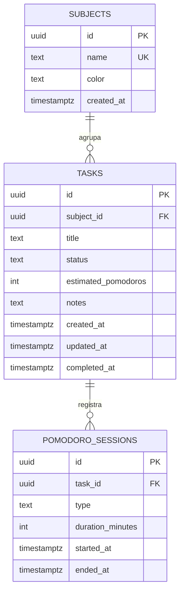

# Trabajo Final — Estudio Track

**Materia:** Generación T
**Alumno:** Ignacio García Belvedere
**Email:** Ignaciogbelvedere@gmail.com
**Fecha:** Noviembre 2026
**Proyecto:** Estudio Track — gestor de estudio con Pomodoro
**Repositorio:** `https://github.com/<usuario>/estudio-track-final` _(completar después del push)_
**Demo:** `https://<sitio>.netlify.app` _(completar después del deploy)_

---

## Índice

1. [Resumen ejecutivo](#1-resumen-ejecutivo)
2. [La consigna y cómo se interpretó](#2-la-consigna-y-cómo-se-interpretó)
3. [El proyecto](#3-el-proyecto)
4. [Especificación funcional](#4-especificación-funcional)
5. [Arquitectura](#5-arquitectura)
6. [Modelo de datos](#6-modelo-de-datos)
7. [API REST](#7-api-rest)
8. [Proceso de trabajo y agentes](#8-proceso-de-trabajo-y-agentes)
9. [Testing](#9-testing)
10. [Frontend](#10-frontend)
11. [Deploy](#11-deploy)
12. [Cómo correr el proyecto](#12-cómo-correr-el-proyecto)
13. [Resultados](#13-resultados)
14. [Mapeo con el curso](#14-mapeo-con-el-curso)
15. [Checklist de entrega](#15-checklist-de-entrega)
16. [Enlaces](#16-enlaces)
17. [Conclusiones](#17-conclusiones)

---

## 1. Resumen ejecutivo

**Estudio Track** es una aplicación web full-stack para organizar el estudio. Permite crear materias, cargar tareas con una estimación en pomodoros, ejecutar un temporizador de 25/5 que registra cada bloque de foco y consultar métricas de avance.

El proyecto retoma la aplicación diseñada en el **TP del Módulo 2** y la lleva hasta el final del recorrido: spec, arquitectura, tests, base de datos, API, frontend, agentes y deploy.

| Dimensión | Resultado |
| --- | --- |
| Stack | React 18 + Vite · Node 22 + Express · PostgreSQL 16 · Neon/Render/Netlify |
| Endpoints | 12 + health check |
| Tablas | 3 (`subjects`, `tasks`, `pomodoro_sessions`) |
| Tests | **19/19 en verde** (5 de dominio + 14 de API) |
| Reglas de negocio | 10, todas cubiertas |
| Build del frontend | 155 kB JS (49,7 kB gzip) + 7,6 kB CSS |
| Dependencias de testing | 0 (runner nativo de Node) |
| Costo de infraestructura | USD 0 (planes gratuitos) |

**Qué demuestra:** que un proyecto chico puede tener proceso grande. La diferencia entre "funciona en mi máquina" y "está listo para entregar" son la spec, los tests, la documentación y el deploy.

---

## 2. La consigna y cómo se interpretó

En el campus, el espacio de entrega final dice únicamente:

> "En este espacio de entrega van a subir su tp final. **Adjunten el link al repo!!!**"

No hay PDF de consigna ni rúbrica asociada (a diferencia de los 12 TPs anteriores). El módulo "Proyecto Final" no tiene clases propias. Por eso el trabajo se guió por el proceso construido a lo largo de la cursada, en particular el **Módulo 4 — "De la spec a internet"**, que trabaja el ciclo completo:

```
especificación → arquitectura → tests → implementación → revisión → deploy
```

y por los artefactos pedidos en los módulos anteriores:

| Módulo | Aporte al trabajo final |
| --- | --- |
| M1 | Uso responsable de IA: agentes con rol, `AGENTS.md`, anti-vibe-coding |
| M2 | El proyecto propio (Estudio Track) y el diseño de la app |
| M3 | Frontend → backend, base de datos, modelo de datos, revisión y métricas |
| M4 | Spec → plan → tareas → tests → deploy en Neon/Render/Netlify |

**Decisión:** entregar un repositorio real, ejecutable y documentado, con el link como pide la consigna, más este documento consolidado y un ZIP de respaldo.

---

## 3. El proyecto

### 3.1 Problema

Quien estudia varias materias reparte su organización entre notas, calendario, timer y planilla. Eso genera tres fricciones:

1. **Falta de visión única:** no se sabe qué queda pendiente por materia.
2. **Estimaciones irreales:** "estudiar 3 horas" no dice cuánto falta realmente.
3. **Poca constancia medible:** sin registro, no hay forma de saber cuánto se estudió.

### 3.2 Solución

Una app donde la unidad de planificación es el **pomodoro** (25 min de foco + 5 de descanso) y la unidad de trabajo es la **tarea**:

- Materias con color.
- Tareas con estado y estimación.
- Timer que registra el foco real.
- Métricas que muestran el avance.

### 3.3 Usuarios

Estudiantes secundarios/universitarios y autodidactas. Una instancia por persona: **sin autenticación** en esta versión (decisión de alcance, no olvido).

### 3.4 Alcance

**Incluido:** materias (crear/listar), tareas (CRUD), filtros, Pomodoro 25/5 con historial, métricas, PostgreSQL, tests, deploy.

**Excluido explícitamente:** login/multiusuario, notificaciones, app móvil, offline, subtareas/etiquetas, edición de materias, i18n.

---

## 4. Especificación funcional

La spec completa está en [`docs/spec.md`](docs/spec.md). Resumen:

### 4.1 Historias de usuario

| ID | Historia | Prioridad |
| --- | --- | --- |
| HU-01 | Crear materia con color | Alta |
| HU-02 | Crear tarea con estimación | Alta |
| HU-03 | Ver y filtrar tareas | Alta |
| HU-04 | Editar tarea (estado, estimación, etc.) | Media |
| HU-05 | Completar y reabrir tarea | Alta |
| HU-06 | Ejecutar y registrar pomodoro | Alta |
| HU-07 | Ver métricas | Media |
| HU-08 | Eliminar tarea | Media |

### 4.2 Criterios de aceptación (muestra)

**HU-06 · Pomodoro**
- Dado que selecciono una tarea e inicio el timer, entonces la cuenta comienza en 25:00.
- Al llegar a 00:00 en modo foco, se registra una sesión y `completedPomodoros` incrementa.
- En modo descanso no se registra sesión de foco.
- `{ type: "break" }` sin duración dura 5 minutos.
- Una duración distinta a la del tipo devuelve `400`.
- Una tarea completada devuelve `409` al intentar registrar.

**HU-03 · Filtros**
- `GET /api/tasks` devuelve todas, ordenadas por creación descendente.
- `?status=pendiente` devuelve solo pendientes.
- `?subjectId=<uuid>` devuelve solo las de esa materia.
- Un estado inválido devuelve `422`.

### 4.3 Reglas de negocio

| ID | Regla | Dónde se aplica |
| --- | --- | --- |
| RN1 | Título de 3 a 120 caracteres | Zod + `check` en DB |
| RN2 | La materia debe existir | Servicio + FK |
| RN3 | No hay pomodoros sobre tareas completadas | `domain/taskRules.js` |
| RN4 | Focus = 25 min · break = 5 min | Dominio + `check` en DB |
| RN5 | Estimación entera 1–50, default 1 | Zod + `check` en DB |
| RN6 | Completar es idempotente; reabrir limpia `completedAt` | Servicio + trigger |
| RN7 | Nombre de materia único (case-insensitive) | Servicio + `unique` |
| RN8 | Borrar tarea borra sus sesiones | FK `on delete cascade` |
| RN9 | Estados: pendiente, en_progreso, completada | Zod + `check` |
| RN10 | Las métricas de foco solo cuentan sesiones `focus` | Repositorio + SQL |

### 4.4 Requisitos no funcionales

Legibilidad por capas, SQL parametrizado, validación de entrada, respuestas < 300 ms en local, responsive de 360 a 1920 px, accesibilidad básica, tests sin DB, Node 22 multiplataforma, deploy gratuito y sin dependencias de testing extra.

---

## 5. Arquitectura

Detalle en [`docs/architecture.md`](docs/architecture.md).

### 5.1 Vista general

```
┌─────────────────────────────┐
│  Frontend (React + Vite)    │
└──────────────┬──────────────┘
               │ fetch JSON
┌──────────────▼──────────────┐
│  API Express                │
│  routes → services → repos  │
│         ↘ domain (reglas)   │
└──────────────┬──────────────┘
               │ SQL parametrizado
┌──────────────▼──────────────┐
│  PostgreSQL (Neon / Docker) │
└─────────────────────────────┘
```

### 5.2 Capas y límites

| Capa | Hace | No hace |
| --- | --- | --- |
| `routes/` | Traduce HTTP ↔ servicio | Reglas ni SQL |
| `services/` | Orquesta reglas y persistencia | Conocer Express o `pg` |
| `domain/` | Reglas puras | I/O |
| `repositories/` | Persiste | Decidir negocio |
| `middleware/` | Errores y 404 | Lógica de negocio |

### 5.3 Inyección de dependencias

```js
const repository = await createRepository();          // memoria | PostgreSQL
const service = createTaskService({ repository, pomodoro: config.pomodoro });
const app = createApp({ service });
```

Esto permite correr la API **sin base de datos** y testear la app real sin mocks de framework.

### 5.4 Flujo de un request

`POST /api/tasks/:id/sessions`:

1. Express parsea el JSON.
2. La ruta llama a `service.registerSession(id, body)`.
3. El servicio busca la tarea (`404` si no existe).
4. Verifica RN3 (`409` si está completada).
5. Valida la forma con Zod (`422`).
6. Verifica RN4 (`400` si la duración no corresponde).
7. Persiste la sesión y responde `201`.

Cualquier error de dominio se traduce en `errorHandler` a `{ error: { code, message } }`.

---

## 6. Modelo de datos

Detalle en [`docs/database.md`](docs/database.md).



Decisiones:

- **`completedPomodoros` no se guarda**: se calcula con `count` sobre las sesiones. Menos riesgo de inconsistencia.
- **Cascadas**: borrar materia borra tareas; borrar tarea borra sesiones.
- **Checks**: la base rechaza estados, títulos y duraciones inválidas aunque alguien escriba SQL directo.
- **Trigger `updated_at`**: no depende del backend.
- **Índices** en `subject_id`, `status`, `created_at` y en las sesiones por `task_id`/`type`.

---

## 7. API REST

Contrato completo en [`docs/api.md`](docs/api.md). Base: `/api`.

| Método | Ruta | Descripción | Éxito |
| --- | --- | --- | --- |
| GET | `/health` | Estado | 200 |
| GET | `/subjects` | Materias | 200 |
| POST | `/subjects` | Crear materia | 201 |
| GET | `/tasks` | Listar/filtrar tareas | 200 |
| POST | `/tasks` | Crear tarea | 201 |
| GET | `/tasks/:id` | Detalle | 200 |
| PATCH | `/tasks/:id` | Actualizar | 200 |
| DELETE | `/tasks/:id` | Eliminar | 204 |
| POST | `/tasks/:id/complete` | Completar | 200 |
| GET | `/tasks/:id/sessions` | Historial | 200 |
| POST | `/tasks/:id/sessions` | Registrar pomodoro | 201 |
| GET | `/stats` | Métricas | 200 |

Formato de error:

```json
{
  "error": {
    "code": "CONFLICT",
    "message": "No se pueden registrar pomodoros sobre una tarea completada. Reabrí la tarea primero."
  }
}
```

Ejemplo de tarea devuelta:

```json
{
  "id": "6a3d...",
  "title": "Resolver guía de integrales",
  "status": "pendiente",
  "estimatedPomodoros": 3,
  "completedPomodoros": 1,
  "totalFocusMinutes": 25,
  "subject": { "id": "8b1c...", "name": "Matemática", "color": "#6366f1" }
}
```

---

## 8. Proceso de trabajo y agentes

Detalle en [`docs/agents.md`](docs/agents.md) y reglas en [`AGENTS.md`](AGENTS.md).

### 8.1 Equipo

| Agente | Produce |
| --- | --- |
| Analista | Spec + criterios de aceptación |
| Arquitecto | Plan, contratos, riesgos |
| Tester | Tests que fallan por la razón correcta |
| Dev | Implementación mínima |
| Revisor | Veredicto con hallazgos |

Ningún agente se autoaprueba. El revisor no es el autor.

### 8.2 Rojo → verde → refactor

Caso real (duración del descanso):

1. **Rojo:** el tester agrega un caso que envía `{ type: "break" }` y espera 5 minutos.
2. **Verde:** el dev ajusta el default según el tipo.
3. **Refactor:** se reutiliza la constante de configuración y se documenta en `docs/api.md`.

El bug existía porque el default siempre era 25. El test lo detectó antes del deploy.

### 8.3 Reglas del repositorio (`AGENTS.md`)

- Nada se implementa sin spec.
- Los tests son el contrato: no se modifican para que pasen.
- Un commit = un cambio lógico.
- Sin secretos en el repo.
- SQL parametrizado siempre.
- Definition of Done con 6 puntos, incluido `npm test` en verde.

### 8.4 Iteraciones

| Iteración | Resultado |
| --- | --- |
| 1. Descubrimiento | Spec con 8 HU y 10 RN |
| 2. Arquitectura | Capas, modelo, contratos, 8 ADR |
| 3. Núcleo | Dominio + servicios + repositorios |
| 4. Interfaz | 12 endpoints + SPA React |
| 5. Entrega | Tests, build, deploy, documentación |

Backlog completo: 37 tareas, todas cerradas ([`docs/tasks.md`](docs/tasks.md)).

---

## 9. Testing

Detalle en [`docs/testing.md`](docs/testing.md).

### 9.1 Herramientas

`node:test` + `node:assert/strict` + `fetch` global. **Cero dependencias de testing.**

Los tests de API levantan la app real en un puerto efímero (`listen(0)`) con el repositorio en memoria. Resultado: suite completa en ~0,3 s, sin Docker ni base de datos.

### 9.2 Resultado

```
# tests 19
# pass 19
# fail 0
```

| Archivo | Tests | Cubre |
| --- | --- | --- |
| `test/rules.test.js` | 5 | RN3, RN4, RN5, RN6 |
| `test/api.test.js` | 14 | 12 endpoints, validaciones y errores |

Casos de API: health, crear materia, duplicado (`409`), crear tarea, título corto (`422`), materia inexistente (`404`), listar/filtrar, actualizar estado, pomodoro focus, pomodoro break, duración inválida (`400`), completar + bloqueo (`409`), estadísticas, eliminar + `404`.

### 9.3 Lo que no está automatizado (y por qué)

- **Persistencia PostgreSQL:** se valida con migración + seed + smoke test. Automatizarla exigiría una DB efímera en CI; el costo no se justifica para el alcance.
- **UI React:** cambios visuales y de interacción se validan con el checklist manual de 13 pasos.
- **Deploy:** smoke test de 10 pasos en producción.

---

## 10. Frontend

### 10.1 Pantallas y componentes

Una sola página con dos columnas (una en mobile):

- **Header** con marca y toggle de tema (dark/light persistido).
- **Stats:** pendientes, en progreso, completadas, pomodoros, minutos.
- **Timer Pomodoro:** modo foco/descanso, cuenta regresiva, pausa, reinicio, selector de tarea.
- **Materias:** alta con color y chips.
- **Filtros:** por materia y estado.
- **Nueva tarea:** título, materia, estimación, notas.
- **Lista de tareas:** estado, progreso `completados/estimados`, enfocar, completar, reabrir, ajustar estimación, eliminar.

### 10.2 Decisiones

- Sin estado global ni router: el tamaño no lo justifica.
- `fetch` propio en `api.js` con manejo uniforme de errores.
- CSS con variables y `data-theme`; sin framework de UI.
- `aria-live` en el timer, labels en todos los inputs, foco visible.

### 10.3 Build

```
dist/index.html                 0,53 kB │ gzip:  0,33 kB
dist/assets/index-*.css         7,57 kB │ gzip:  2,28 kB
dist/assets/index-*.js        155,17 kB │ gzip: 49,74 kB
```

---

## 11. Deploy

Guía paso a paso en [`docs/deploy.md`](docs/deploy.md).

| Servicio | Rol | Configuración |
| --- | --- | --- |
| **Neon** | PostgreSQL | Connection string con `sslmode=require` |
| **Render** | API | Root `backend/`, `npm ci`, `npm start`, health `/api/health` |
| **Netlify** | SPA | Base `frontend/`, `npm run build`, publish `dist` |

Variables:

| Dónde | Variable | Valor |
| --- | --- | --- |
| Render | `DATABASE_URL` | connection string de Neon |
| Render | `CORS_ORIGIN` | URL exacta de Netlify |
| Render | `NODE_ENV` | `production` |
| Netlify | `VITE_API_URL` | `https://<api>.onrender.com/api` |

Pasos posteriores al primer deploy:

```bash
cd backend
DATABASE_URL=<neon> npm run migrate
DATABASE_URL=<neon> npm run seed   # opcional
```

Verificación: `GET /api/health` → `{"status":"ok"}`.

---

## 12. Cómo correr el proyecto

### Sin base de datos (modo demo)

```bash
cd backend
npm install
npm run dev
# API en http://localhost:3000 con datos en memoria
```

```bash
cd frontend
npm install
npm run dev
# SPA en http://localhost:5173
```

### Con PostgreSQL

```bash
docker compose up -d

cd backend
copy .env.example .env    # completar DATABASE_URL
npm run migrate
npm run seed
npm run dev
```

### Tests y build

```bash
cd backend && npm test          # 19/19
cd frontend && npm run build    # dist/
```

---

## 13. Resultados

| Métrica | Valor |
| --- | --- |
| Tests | 19/19 |
| Endpoints | 12 + health |
| Reglas de negocio cubiertas | 10/10 |
| Tareas del backlog cerradas | 37/37 |
| Documentos | 9 en `docs/` + README + AGENTS + este documento |
| Agentes definidos | 5 |
| Dependencias de producción (backend) | 5 |
| Dependencias de testing | 0 |
| Tamaño del frontend (gzip) | ~50 kB JS + 2,3 kB CSS |
| Tiempo de suite | ~0,3 s |
| Costo mensual | USD 0 |

---

## 14. Mapeo con el curso

| Módulo | Contenido | Evidencia en el proyecto |
| --- | --- | --- |
| **M1** | IA responsable, agentes, anti-vibe-coding | `AGENTS.md`, `agents/*.md`, `docs/agents.md`, revisión independiente |
| **M2** | Proyecto propio, diseño de app | Estudio Track nace acá; identidad visual y flujo se mantienen |
| **M3** | Frontend → backend, DB, modelo de datos, tickets, revisión | API REST, PostgreSQL, modelo relacional, tests, revisión |
| **M4** | Spec → plan → tareas → tests → deploy | `docs/spec.md`, `docs/plan.md`, `docs/tasks.md`, `backend/test/`, `docs/deploy.md` |

Cada etapa dejó un artefacto verificable, no solo código.

---

## 15. Checklist de entrega

- [x] Repositorio con código backend y frontend
- [x] Spec, plan y backlog
- [x] Modelo de datos y migración idempotente
- [x] API REST documentada
- [x] Tests automatizados en verde (19/19)
- [x] Build de producción del frontend
- [x] `AGENTS.md` y equipo de agentes
- [x] Configuración de deploy (`render.yaml`, `netlify.toml`)
- [x] CI con GitHub Actions
- [x] README con instrucciones
- [x] Documento consolidado de entrega
- [ ] Push del repositorio a GitHub _(paso del alumno)_
- [ ] Deploy en Neon + Render + Netlify _(paso del alumno)_
- [ ] Link del repo pegado en el campus _(paso del alumno)_

---

## 16. Enlaces

| Recurso | URL |
| --- | --- |
| Repositorio | `https://github.com/<usuario>/estudio-track-final` |
| Demo | `https://<sitio>.netlify.app` |
| API | `https://<servicio>.onrender.com/api/health` |
| Documentación | `docs/` dentro del repo |

> Reemplazar los placeholders después de publicar. El ZIP de entrega incluye el proyecto completo con la documentación.

---

## 17. Conclusiones

1. **La spec es una herramienta, no un trámite.** Dos decisiones se resolvieron escribiendo el criterio antes del código: qué pasa al registrar un descanso y cómo se reabre una tarea.
2. **Los tests dan velocidad, no la quitan.** 19 tests que corren en 0,3 s permitieron cambiar el servicio sin miedo y detectar un bug real antes del deploy.
3. **La arquitectura en capas paga cuando el proyecto crece.** Separar dominio, servicio y repositorio permitió testear sin base de datos y cambiar la persistencia sin tocar las reglas.
4. **El deploy es parte del producto.** Una app que solo corre en local no está terminada; el health check, las variables de entorno y CORS son parte del trabajo.
5. **La IA rinde con contrato claro.** Roles definidos, artefactos y revisión independiente producen mejor resultado que pedir "hacé una app".
6. **El alcance negativo protege.** Decir explícitamente qué no se hace evitó sumar login, notificaciones y mobile, que hubieran puesto en riesgo la entrega.

**Próximos pasos posibles:** autenticación multiusuario, tests de contrato de `pgTaskRepository` contra una DB efímera, notificaciones de fin de pomodoro y una vista semanal de constancia.
