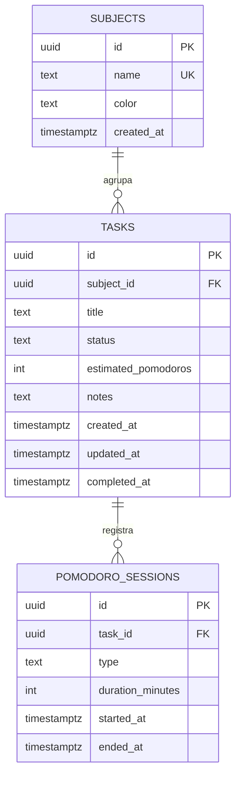

# Modelo de datos — Estudio Track

Motor: **PostgreSQL 16**. En producción, Neon (serverless); en local, Docker.

## 1. Diagrama entidad-relación



Relaciones:

- Una **materia** tiene muchas **tareas** (`1:N`). Borrar la materia borra sus tareas.
- Una **tarea** tiene muchas **sesiones** (`1:N`). Borrar la tarea borra sus sesiones.

## 2. Tablas

### `subjects`

| Columna | Tipo | Restricción | Motivo |
| --- | --- | --- | --- |
| `id` | `uuid` | PK, `gen_random_uuid()` | Identidad estable |
| `name` | `text` | `not null`, `unique` | Evita duplicados (RN7) |
| `color` | `text` | `not null`, `check ~ '^#[0-9a-fA-F]{6}$'` | Color válido para la UI |
| `created_at` | `timestamptz` | `not null default now()` | Orden y auditoría |

### `tasks`

| Columna | Tipo | Restricción | Motivo |
| --- | --- | --- | --- |
| `id` | `uuid` | PK | Identidad |
| `subject_id` | `uuid` | FK → `subjects(id)` `on delete cascade` | Integridad (RN8) |
| `title` | `text` | `check char_length between 3 and 120` | RN1 |
| `status` | `text` | `default 'pendiente'`, `check in (...)` | RN9 |
| `estimated_pomodoros` | `int` | `default 1`, `check between 1 and 50` | RN5 |
| `notes` | `text` | `check char_length <= 500` | Límite de UI/API |
| `created_at` | `timestamptz` | `default now()` | Orden |
| `updated_at` | `timestamptz` | `default now()` + trigger | Auditoría |
| `completed_at` | `timestamptz` | nullable | RN6 |

### `pomodoro_sessions`

| Columna | Tipo | Restricción | Motivo |
| --- | --- | --- | --- |
| `id` | `uuid` | PK | Identidad |
| `task_id` | `uuid` | FK → `tasks(id)` `on delete cascade` | RN8 |
| `type` | `text` | `default 'focus'`, `check in ('focus','break')` | RN4 |
| `duration_minutes` | `int` | `check > 0 and <= 120` | Evita datos basura |
| `started_at` | `timestamptz` | `default now()` | Historial |
| `ended_at` | `timestamptz` | nullable | Cierre de la sesión |

> La API además exige 25/5 exactos (RN4). El `check` de la base es la última red de seguridad, no la regla principal.

## 3. Índices

| Índice | Tabla | Para qué |
| --- | --- | --- |
| `idx_tasks_subject` | `tasks(subject_id)` | Filtro por materia + join |
| `idx_tasks_status` | `tasks(status)` | Filtro por estado y métricas |
| `idx_tasks_created` | `tasks(created_at desc)` | Listado ordenado |
| `idx_sessions_task` | `pomodoro_sessions(task_id)` | Historial por tarea |
| `idx_sessions_type` | `pomodoro_sessions(type)` | Agregados de foco |

Con el volumen esperado (decenas/cientos de filas) los índices no son críticos, pero documentan las consultas reales y evitan degradación si el dataset crece.

## 4. Consultas clave

### Tarea con pomodoros completados (subconsulta)

```sql
select
  t.*,
  coalesce((
    select count(*) from pomodoro_sessions p
    where p.task_id = t.id and p.type = 'focus'
  ), 0)::int as completed_pomodoros
from tasks t
join subjects s on s.id = t.subject_id;
```

Se calcula en lectura en lugar de mantener un contador: menos riesgo de inconsistencia, y el volumen no justifica denormalizar.

### Listado con filtros opcionales

```sql
select ...
from tasks t
join subjects s on s.id = t.subject_id
where ($1::uuid is null or t.subject_id = $1)
  and ($2::text is null or t.status = $2)
order by t.created_at desc;
```

Un solo prepared statement cubre los cuatro casos (sin filtros, por materia, por estado, por ambos).

### Métricas

```sql
select status, count(*)::int as count from tasks group by status;

select count(*)::int as count,
       coalesce(sum(duration_minutes), 0)::int as minutes
from pomodoro_sessions
where type = 'focus';
```

## 5. Integridad y consistencia

- **Claves foráneas con cascada:** no quedan sesiones huérfanas ni tareas sin materia.
- **Checks en base:** aunque alguien escriba directo en SQL, no entran estados ni duraciones inválidas.
- **Trigger `touch_updated_at`:** `updated_at` no depende de que el backend se acuerde.
- **Transacciones:** las operaciones actuales son de una sola sentencia; si se agrega lógica multi-tabla, se envolverá en `BEGIN/COMMIT`.

## 6. Migración y seed

```bash
cd backend
npm run migrate   # aplica schema.sql (idempotente)
npm run seed      # datos demo si la base está vacía
```

`schema.sql` usa `create table if not exists`, `create index if not exists` y `drop trigger if exists`, por lo que puede ejecutarse varias veces sin romper.

## 7. Diferencias entre repositorios

| Aspecto | `memoryTaskRepository` | `pgTaskRepository` |
| --- | --- | --- |
| Persistencia | Arrays en proceso | PostgreSQL |
| `completedPomodoros` | `filter + length` | Subconsulta `count` |
| IDs | `randomUUID()` | `gen_random_uuid()` |
| Cascada | `splice` manual | `on delete cascade` |
| Uso | Demo y tests | Producción |

Ambos respetan el mismo contrato; los tests de API validan el comportamiento sobre la versión en memoria y el deploy valida la versión PostgreSQL con el seed.
